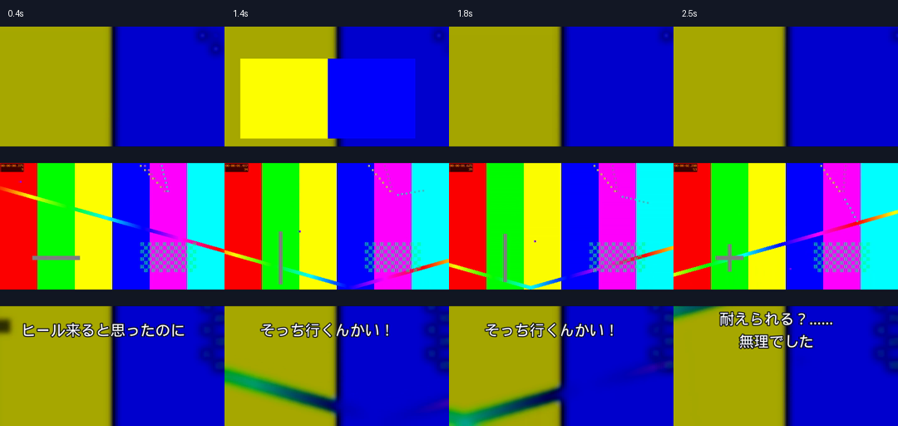

# Shorts Generator — 縦型ショート動画のローカル制作ツール

[](https://github.com/taki-codes/shorts-generator-portfolio/actions/workflows/verify.yml)

[設計・コードの読みどころと検証結果](docs/portfolio.md)

ゲーム映像、コメント、編集案を入力し、PythonとFFmpegで9:16のショート動画を書き出すツールです。カット・速度変更・静止・リプレイ・拡大パネル・字幕・読み上げ・効果音を、JSONの編集案から再現します。

元映像の全体表示を残し、指定した字幕にはRemotionのアニメーションを追加できます。制作物ごとに設定、素材のハッシュ、処理状態を保存し、確認用プレビューから完成版へ進めます。

## 合成素材によるサンプル

[確認用MP4](examples/demo-output/synthetic-preview.mp4) / [処理結果](examples/demo-output/synthetic-summary.json)



実際のゲーム映像・実VOICEVOX音声・投稿実績ではなく、処理を確認するテスト素材です。

## 主な機能

- FFprobeによる素材の計測、フレーム一覧、映像・音声プロキシの生成
- 元のコメントと指定時刻を検証しながら、カットや字幕を配置
- VOICEVOXによる読み上げ生成、持ち込み音声、字幕と音声の時間枠チェック
- ゲーム音・読み上げ・効果音の独立ステム、ダッキング、ラウドネス処理
- 指定した字幕だけReact / Remotionで透明MOVを生成し、FFmpegで合成
- 540×960の確認用動画と1080×1920の完成動画、SRT、字幕PNG、XML候補を出力
- 字幕サイズや演出回数などの好みを、変更理由と履歴付きで保存
- YouTubeの非公開アップロードと状態確認、TikTok操作用の引き継ぎ資料生成

## 技術構成

| 用途 | 技術 |
| --- | --- |
| CLI・編集処理 | Python 3.11〜3.13、FFmpeg / FFprobe、Pillow |
| 音声合成 | ローカルVOICEVOX EngineのHTTP API |
| 字幕アニメーション | Remotion 4.0.536、React 19、Node.js、Chrome / Edge |
| YouTube連携（任意） | YouTube Data API v3、Google OAuth、Windows DPAPI |
| テスト | unittest、模擬VOICEVOX、合成テスト映像 |

```text
素材 + コメント原文 + 編集案（plan.json）
                 │
                 ▼
          入力・時刻・音声の検証
                 │
      FFmpeg / Pillow / 任意のRemotion
                 │
                 ▼
     プレビュー → 確認・修正 → 完成版
                 │
       MP4・字幕・音声・設定・処理記録
```

編集案は人が作成するほか、ローカルのコーディングエージェントへ自然文で依頼して作成できます。Python本体は自然言語の解釈、ゲームの見せ場の意味解析、音声文字起こしを行いません。

## セットアップ

主な利用環境はWindows 11です。通常版64bitのPython 3.11〜3.13と、PATHから呼び出せるFFmpeg / FFprobeを用意してください。free-threaded版Pythonはセットアップの対象外です。

```powershell
git clone https://github.com/taki-codes/shorts-generator-portfolio.git
cd shorts-generator-portfolio

py -3.13 -m venv .venv
.\.venv\Scripts\python.exe -m pip install --only-binary=:all: -e .
.\.venv\Scripts\python.exe -m owshort.cli --help
```

Windows向けの導入補助は `scripts/bootstrap.ps1` です。`-InstallTools` は不足するPython / FFmpeg、`-InstallCodex` はNode.js / Codex CLI、`-YouTube` はYouTube用Python依存の導入を含みます。利用する項目だけ指定してください。

```powershell
powershell -NoProfile -File .\scripts\bootstrap.ps1 -YouTube
.\.venv\Scripts\python.exe -m owshort.cli doctor --out diagnostics.json
```

通常字幕だけならNode.js / Remotionは不要です。アニメーション字幕を使う場合は `remotion/` で `npm.cmd ci` を実行します。詳細は [Remotionの手順](docs/remotion.md) を参照してください。

| 設定 | 場所・用途 |
| --- | --- |
| 字幕、配置、音量、出力、フォント | `config/preferences.json` |
| VOICEVOX接続先 | `voicevox_url`。既定は `http://127.0.0.1:50021` |
| Remotion用ブラウザー | 任意の環境変数 `OWSHORT_REMOTION_BROWSER` |
| YouTube OAuth | 任意。手順は [docs/youtube.md](docs/youtube.md) |

VOICEVOXは別途起動します。使用する話者の利用条件と必要なクレジットを確認してください。通常の編集・書き出しに外部LLMのAPIキーは不要です。

## 制作の流れ

以下は `C:\Videos\clip.mp4` に素材がある場合の例です。素材はコピーせず元ファイルを参照します。

```powershell
# 原文・指示・素材のパスを新しいジョブへ保存
.\.venv\Scripts\python.exe scripts/new_project.py first 'C:\Videos\clip.mp4' --comments examples/comments.txt --brief examples/brief.md

# フレームとプロキシを作成し、元映像・音声を確認
.\.venv\Scripts\python.exe -m owshort.cli analyze jobs/first/project.json
```

`jobs/first/proposal.md` に編集方針、`jobs/first/plan.json` に区間・字幕・効果音などを記述します。形式は [編集案のスキーマ](docs/schema.md)、エージェント向けの制作手順は [AGENTS.md](AGENTS.md) を参照してください。参考URLは記録されるだけで、このCLIは参考動画をダウンロードしません。

読み上げを使う場合は `speakers` で話者IDを確認し、`project.json` の `voicevox.speaker_id` とコメントの `mode: "voice_subtitle"` を設定してから `tts` を実行します。字幕のみのコメントは `mode: "subtitle"` です。

```powershell
.\.venv\Scripts\python.exe -m owshort.cli speakers
.\.venv\Scripts\python.exe -m owshort.cli tts jobs/first/project.json --plan jobs/first/plan.json

.\.venv\Scripts\python.exe -m owshort.cli validate jobs/first/project.json jobs/first/plan.json
.\.venv\Scripts\python.exe -m owshort.cli render jobs/first/project.json jobs/first/plan.json --stage preview

# プレビューの映像・音声を確認し、編集案を修正してから実行
.\.venv\Scripts\python.exe -m owshort.cli render jobs/first/project.json jobs/first/plan.json --stage final
```

字幕だけのジョブでは `speakers` と `tts` を省略できます。書き出しごとに `jobs/first/build/<日時>-<stage>/` を新規作成します。

## コードの見どころ

- **検証してから書き出す**: 素材の範囲外、字幕の画面外、音声の時間超過、原文の無断変更などを検出します。
- **フレーム単位の時間管理**: カットや静止の長さを出力fpsへ丸め、完成動画の時刻を積み上げます。
- **処理を追跡できる生成物**: 設定のスナップショット、素材と動画のSHA-256、ツールの版、成功・失敗をmanifestへ保存します。
- **字幕の部分拡張**: 通常はPillow字幕を使い、明示したコメントだけRemotionへ渡します。指定内容と生成素材も記録します。
- **外部送信の状態管理**: YouTubeの対象チャンネルを照合し、処理中・非公開完了・失敗・確認待ちを分けます。合成テスト動画のアップロードは拒否します。

## 構成と関連資料

```text
owshort/       CLI、入力検証、レンダー、音声、外部連携
scripts/       Windows導入補助、新規ジョブ作成
config/        表示・音量・編集方針の設定
remotion/      字幕用のReactソースとレンダー処理
examples/      入力例と合成テストの資料
tests/         入力契約・環境互換性・メディア統合テスト
docs/          スキーマ、Remotion、Premiere、投稿連携
jobs/          素材参照、編集案、生成物（Git対象外）
```

- [Premiereへの受け渡し](docs/premiere.md)
- [YouTubeの非公開アップロード](docs/youtube.md)
- [ブラウザ接続とTikTok操作](docs/browser.md)
- [既存の検証記録](VALIDATION.md)

YouTube OAuthトークンはWindowsのDPAPIで暗号化し、ユーザーの `LOCALAPPDATA` 配下に保存します。TikTokは引き継ぎ資料の生成までをCLIが担当し、実際の操作結果はブラウザ側で確認します。

## 検証範囲と制約

```powershell
.\.venv\Scripts\python.exe -B -m unittest discover -s tests -v
```

2026年11月8日にWindows / Python 3.13.1 / FFmpeg 9.0.2で、レンダー統合テスト6件を含む通常の16テストが成功しました。合成素材からプレビューと1080×1920のfinalを書き出しました。実VOICEVOX音声、外部認証、投稿は今回の確認に含めていません。

過去の検証は [VALIDATION.md](VALIDATION.md) と [Remotionの実機検証記録](docs/remotion.md#2026-10-17の実機検証) に分けて記録しています。2026年10月17日の記録には透明MOV生成、通常字幕との混在、1080×1920のfinal出力の確認があります。

- Premiere用XMLは受け渡し候補です。実機での読み込み・再編集・再書き出しは別途確認が必要です。XMLの字幕は静止PNGで、Remotionの動きはMP4と透明MOVに保存します。
- 音声文字起こし、話者分離、被写体追跡、公開・予約投稿のCLIは実装していません。
- YouTube OAuth / DPAPIと実投稿、TikTokの実操作、実VOICEVOX話者の音声確認を、上記の単体テスト成功で代替していません。
- 実Remotionの統合テストは `OWSHORT_TEST_REMOTION=1` を指定する任意実行です。共通テストは新規クローンだけで実行できるfixtureへ分離しました。既存ジョブ専用テストは任意で、そのファイルがなければスキップします。今回の実Remotion処理は完了せず中断したため、成功には数えていません。
- 元素材、音声、ゲーム映像の利用条件と、投稿時点のサービス仕様は個別に確認してください。

## ライセンス

現時点ではリポジトリにライセンスファイルを設定していません。コード、動画、音声、画像などの再利用条件は別途確認してください。

## この公開用ソースについて

[元のコードとの差分・含める範囲](PORTFOLIO-SOURCE.md)を参照してください。個別の運用情報と元のGit履歴を含まない公開用ソースです。
